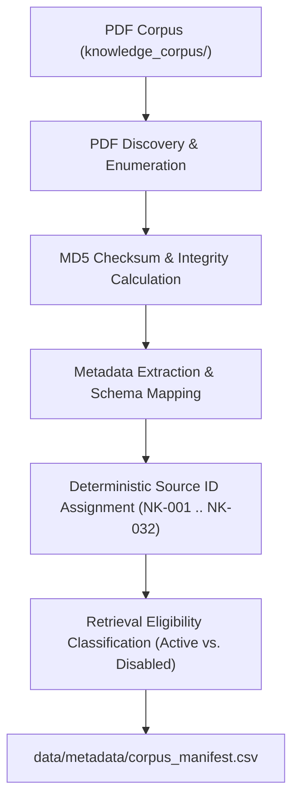

# Phase 1 — PDF Corpus Ingestion & Manifest

**Primary Owner:** Abhiram  
**Phase Status:** **PASSED (15 / 15 Validation Tests Passing — 100.0%)**  

---

## 1. Objective

Phase 1 establishes the foundational data ingestion pipeline for the NutriKid RAG system. The objective of this phase is to systematically discover all physical PDF documents within the domain corpus, compute cryptographic byte checksums, extract structured publication metadata, enforce target domain age boundaries ($5.0 \le \text{child\_age} \le 15.0$ years), partition documents into active vs. disabled retrieval tiers, and assign deterministic source identifiers (`NK-001` through `NK-032`). This creates an immutable metadata registry (`corpus_manifest.csv`) required by all downstream parsing, chunking, indexing, and retrieval phases.

---

## 2. Input

- **Source Corpus Directory:** [`knowledge_corpus/`](file:///c:/Users/abhir/.android/OneDrive/Desktop/nlp-class/NLP-Implementation-casestudy/NLP-Implementation/knowledge_corpus/)
- **Input Data Format:** Raw PDF documents organized across 5 authority tier subdirectories:
  1. `01_PRIMARY_KNOWLEDGE` (16 source PDFs)
  2. `02_SUPPORTING_KNOWLEDGE` (8 source PDFs)
  3. `03_EVALUATION_CONTEXT` (2 source PDFs)
  4. `04_OUT_OF_SCOPE_INFANT` (5 source PDFs)
  5. `05_REFERENCE_ONLY` (1 source PDF)
- **Actual Measured PDF Count:** **32 PDF documents** (matches expected baseline of 32).

---

## 3. Component Implemented

- **Primary Generator Script:** [`preprocessing/generate_manifest.py`](file:///c:/Users/abhir/.android/OneDrive/Desktop/nlp-class/NLP-Implementation-casestudy/NLP-Implementation/preprocessing/generate_manifest.py)
- **Validator Script:** [`preprocessing/validate_manifest.py`](file:///c:/Users/abhir/.android/OneDrive/Desktop/nlp-class/NLP-Implementation-casestudy/NLP-Implementation/preprocessing/validate_manifest.py)
- **Technical Description:**
  - `generate_manifest.py` recursively traverses `knowledge_corpus/`, discovering all physical `.pdf` files.
  - Computes byte-exact MD5 cryptographic checksums (`calculate_md5`) to guarantee file integrity and detect duplicate file buffers.
  - Sorts discovered files deterministically by subdirectory folder and file name to generate stable source identifiers (`NK-001` to `NK-032`).
  - Maps verified domain metadata (title, publisher, publication year, document type, authority tier, domain, `age_min`, `age_max`).
  - Classifies retrieval eligibility (`retrieval_enabled = true` or `false`) based on authority tiers, target pediatric age bounds, and duplicate content detection.

---

## 4. Output

- **Primary Output Artifact:** [`data/metadata/corpus_manifest.csv`](file:///c:/Users/abhir/.android/OneDrive/Desktop/nlp-class/NLP-Implementation-casestudy/NLP-Implementation/data/metadata/corpus_manifest.csv)
- **Manifest Schema (13 Mandatory Headers):**
  1. `source_id`: Unique deterministic ID (`NK-001` .. `NK-032`)
  2. `source_name`: Full authoritative document title
  3. `file_name`: Exact PDF filename on disk
  4. `relative_path`: Relative filesystem path (`knowledge_corpus/.../*.pdf`)
  5. `folder`: Source tier folder name
  6. `publisher`: Publishing authority (WHO, ICMR-NIN, FSSAI, FAO, IIPS)
  7. `publication_year`: Year of publication (2003–2025)
  8. `document_type`: Type classification (Guideline, Reference Book, Survey Report, etc.)
  9. `authority_tier`: Authority level (Tier 1 through Tier 5)
  10. `domain`: Nutrition domain category (Macronutrient Intake, Dietary Guidelines, etc.)
  11. `age_min`: Minimum target age bound
  12. `age_max`: Maximum target age bound
  13. `retrieval_enabled`: Boolean string (`true` / `false`) indicating RAG index inclusion

---

## 5. Workflow



---

## 6. Validation

Executed automated contract test suite [`preprocessing/test_phase1_manifest.py`](file:///c:/Users/abhir/.android/OneDrive/Desktop/nlp-class/NLP-Implementation-casestudy/NLP-Implementation/preprocessing/test_phase1_manifest.py):

| Test ID | Test Description | Measured Outcome | Status |
| :--- | :--- | :---: | :---: |
| **P1-01** | PDF discovery under `knowledge_corpus/` | 32 / 32 PDFs discovered | **PASS** |
| **P1-02** | Discovered PDF count parity | Discovered 32 = Expected 32 | **PASS** |
| **P1-03** | Manifest file existence check | File exists at `data/metadata/corpus_manifest.csv` | **PASS** |
| **P1-04** | Manifest CSV readability & parsing | Successfully parsed with `csv.DictReader` | **PASS** |
| **P1-05** | 1:1 PDF-to-manifest mapping parity | 32 / 32 exact relative path match | **PASS** |
| **P1-06** | Source ID uniqueness check | 32 / 32 unique IDs (0 duplicates) | **PASS** |
| **P1-07** | Relative path uniqueness check | 32 / 32 unique paths (0 duplicates) | **PASS** |
| **P1-08** | Manifest path existence on disk | 32 / 32 paths exist on disk | **PASS** |
| **P1-09** | Required schema columns presence | 13 / 13 columns present | **PASS** |
| **P1-10** | `retrieval_enabled` value validity | 32 / 32 values in `{"true", "false"}` | **PASS** |
| **P1-11** | Active vs. disabled document counts | 22 active, 10 disabled | **PASS** |
| **P1-12** | PDF & manifest byte integrity check | 0 PDF buffer changes, 0 hash drift | **PASS** |
| **P1-13** | Missing source ID check | 0 missing source IDs | **PASS** |
| **P1-14** | Duplicate source ID check | 0 duplicate source IDs | **PASS** |
| **P1-15** | Internal metadata consistency | 100.0% completeness & valid tiers | **PASS** |

---

## 7. Quantitative Results

| Metric | Expected Value | Actual Measured Value | Status |
| :--- | :---: | :---: | :---: |
| **Total PDF Files** | 32 | **32** | **PASS** |
| **Active Retrieval Documents** | 22 | **22** | **PASS** |
| **Disabled Retrieval Documents** | 10 | **10** | **PASS** |
| **Duplicate Source IDs** | 0 | **0** | **PASS** |
| **Missing PDF Paths** | 0 | **0** | **PASS** |
| **Metadata Schema Errors** | 0 | **0** | **PASS** |
| **PDF Bytes Modified** | 0 | **0** | **PASS** |

---

## 8. Evidence for Demonstration

To demonstrate Phase 1 verification to the teacher/evaluator, execute the following command in the terminal:

```bash
python preprocessing/test_phase1_manifest.py
```

Expected Terminal Output:
```text
==================================================
PHASE 1 — CORPUS INGESTION & MANIFEST VALIDATION
==================================================

PDF corpus:
  Total PDFs discovered: 32
  Expected PDFs: 32
  Status: PASS

Manifest:
  Manifest exists: PASS
  CSV readable: PASS

Source IDs:
  Total source IDs: 32
  Duplicate IDs: 0
  Missing IDs: 0
  Status: PASS

Retrieval status:
  Active documents: 22
  Disabled documents: 10
  Status: PASS

Path validation:
  Existing PDF paths: 32/32
  Missing PDF paths: 0
  Status: PASS

Metadata:
  Required fields present: PASS
  Invalid values: 0
  Status: PASS

Integrity:
  PDFs modified during validation: 0
  Manifest unexpectedly modified: 0
  Status: PASS

==================================================
PHASE 1 RESULT: PASS
==================================================
```

---

## 9. Final Result

```text
==================================================
PHASE 1 PASSED
==================================================
```
