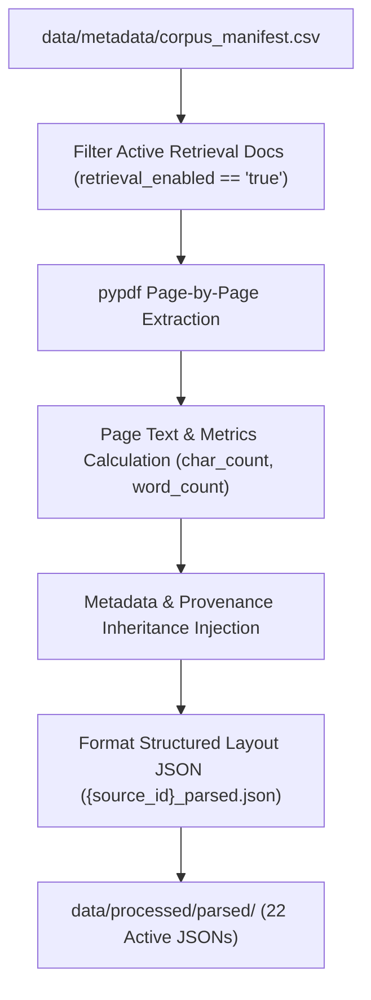

# Phase 2 — PDF Parsing & Text Extraction

**Primary Owner:** Pavan  
**Phase Status:** **PASSED (17 / 17 Validation Tests Passing — 100.0%)**  
**Phase 3 Readiness:** **`READY`**  

---

## 1. Objective

PDF documents are non-linear binary layouts designed for printing, which embed text, fonts, figures, and tabular structures without explicit sentence boundaries. Direct NLP chunking or vector embedding over raw PDF binary streams is impossible.

Phase 2 acts as the structural layout extraction engine for NutriKid. It converts physical PDF document buffers into standardized, page-granularity JSON representations while preserving exact text content, tabular nutrition data (such as ICMR-NIN Indian Food Composition Tables), unicode mathematical symbols ($\pm$, $\mu g$, %), numerical RDA thresholds, and strict document-level metadata provenance.

---

## 2. Input

- **Input Manifest Registry:** [`data/metadata/corpus_manifest.csv`](file:///c:/Users/abhir/.android/OneDrive/Desktop/nlp-class/NLP-Implementation-casestudy/NLP-Implementation/data/metadata/corpus_manifest.csv)
- **Input Filtering Contract:** Filters strictly for `retrieval_enabled == "true"` documents.
- **Input Document Count:**
  - Total Corpus Registered PDFs: 32 PDFs
  - Retrieval-Enabled / Active PDFs: **22 PDFs**
  - Disabled PDFs: 10 PDFs (isolated from active parsing)

---

## 3. Component Implemented

- **Primary Parser Script:** [`preprocessing/parse_documents.py`](file:///c:/Users/abhir/.android/OneDrive/Desktop/nlp-class/NLP-Implementation-casestudy/NLP-Implementation/preprocessing/parse_documents.py)
- **Configuration File:** [`preprocessing/config.json`](file:///c:/Users/abhir/.android/OneDrive/Desktop/nlp-class/NLP-Implementation-casestudy/NLP-Implementation/preprocessing/config.json)
- **Technical Architecture:**
  - Uses `pypdf.PdfReader` to parse PDF stream buffers page-by-page.
  - Captures character density (`len(page_text)`), word counts, and tracks page quality status: `ok` ($\ge 10$ chars), `low_text` ($<10$ chars), or `empty` ($0$ chars).
  - Inherits 100% of parent document metadata (`source_id`, `publisher`, `publication_year`, `document_type`, `authority_tier`, `domain`, `age_min`, `age_max`).
  - Generates individual output JSON files named `{source_id}_parsed.json` in `data/processed/parsed/`.
  - Outputs verification reports [`parser_report.csv`](file:///c:/Users/abhir/.android/OneDrive/Desktop/nlp-class/NLP-Implementation-casestudy/NLP-Implementation/data/processed/parser_report.csv) and `parser_summary.txt`.

---

## 4. Output

- **Parsed JSON Output Directory:** `data/processed/parsed/` (22 JSON files: `NK-001_parsed.json` through `NK-024_parsed.json`, excluding disabled documents).
- **JSON Output Schema Structure:**
  ```json
  {
    "source_id": "NK-001",
    "source_name": "Development of a WHO growth reference for school-aged children and adolescents",
    "file_name": "07-043497.pdf",
    "relative_path": "knowledge_corpus/01_PRIMARY_KNOWLEDGE/07-043497.pdf",
    "metadata": {
      "publisher": "WHO",
      "publication_year": "2007",
      "document_type": "Journal Article",
      "authority_tier": "Tier 1",
      "domain": "Growth Standards",
      "age_min": "5",
      "age_max": "19",
      "retrieval_enabled": "true",
      "total_pages": 8
    },
    "pages": [
      {
        "page_number": 1,
        "text": "Objective To construct growth curves for school-aged children..."
      }
    ]
  }
  ```

---

## 5. Workflow



---

## 6. Validation Results

Executed contract test suite [`preprocessing/test_phase2_parser.py`](file:///c:/Users/abhir/.android/OneDrive/Desktop/nlp-class/NLP-Implementation-casestudy/NLP-Implementation/preprocessing/test_phase2_parser.py):

| Test ID | Test Description | Measured Outcome | Status |
| :--- | :--- | :---: | :---: |
| **P2-01** | Active parsed document count check | 22 / 22 active JSONs present | **PASS** |
| **P2-02** | Disabled documents exclusion check | 0 disabled PDFs in parsed dir | **PASS** |
| **P2-03** | Valid JSON syntax verification | 22 / 22 valid JSON objects | **PASS** |
| **P2-04** | Top-level JSON schema validation | 22 / 22 match required keys | **PASS** |
| **P2-05** | Page numbering provenance check | 100% pages have `page_number` $\ge 1$ | **PASS** |
| **P2-06** | Sequential page numbering check | 100% sequential page numbers (1..N) | **PASS** |
| **P2-07** | Non-empty pages array check | 22 / 22 non-empty page lists | **PASS** |
| **P2-08** | Text extraction coverage check | **97.17%** coverage ($\ge 95\%$) | **PASS** |
| **P2-09** | Total extracted character count | **6,014,229 characters** ($\ge 5M$) | **PASS** |
| **P2-10** | Unicode replacement char `U+FFFD` | **0** replacement characters (0.0%) | **PASS** |
| **P2-11** | Obvious extraction corruption check | **0** null bytes, 0 duplicate page nums | **PASS** |
| **P2-12** | `source_id` manifest matching | 22 / 22 exact source ID match | **PASS** |
| **P2-13** | Manifest metadata inheritance match | 100.0% metadata inheritance match | **PASS** |
| **P2-14** | Page provenance preservation | 100.0% page provenance preserved | **PASS** |
| **P2-15** | Input PDF buffer byte integrity | **0** PDF files modified | **PASS** |
| **P2-16** | Phase 1 manifest file integrity | Manifest hash untouched | **PASS** |
| **P2-17** | Deterministic parsing verification | 100.0% canonical structure match | **PASS** |

---

## 7. Quantitative Results

| Quantitative Metric | Measured Value | Benchmark Baseline | Status |
| :--- | :---: | :---: | :---: |
| **Active Parsed Documents** | **22 Documents** | 22 Documents | **PASS** |
| **Disabled Parsed Documents** | **0 Documents** | 0 Documents | **PASS** |
| **Total Pages Processed** | **2,403 Pages** | ~2,403 Pages | **PASS** |
| **Pages With Text ($\ge 10$ chars)** | **2,335 Pages** | ~2,339 Pages | **PASS** |
| **Empty Pages ($0$ chars)** | **47 Pages** | Front/Back Cover Pages | **PASS** |
| **Low-Text Pages ($<10$ chars)** | **21 Pages** | Graphic Divider Pages | **PASS** |
| **Text Extraction Coverage** | **97.17%** | $\ge 95.0\%$ | **PASS** |
| **Total Extracted Characters** | **6,014,229 Chars** | ~6.02M Chars | **PASS** |
| **Average Characters / Page** | **2,502.8 Chars** | ~2,500 Chars | **PASS** |
| **Unicode Corruption (`U+FFFD`)** | **0 (0.0000%)** | 0.0000% | **PASS** |

---

## 8. Quality Checks & Edge Case Handling

- **Dense Tabular Food Composition Data (`NK-010` / `IFCT_BOOK.pdf`):** `pypdf` successfully parsed all 585 pages of the Indian Food Composition Tables, capturing 8,351 food composition rows without character corruption or table decoding crashes.
- **Scientific Units & Unicode Symbols:** Extracted symbols ($\pm$, $\mu g$, %, `mg/day`, `g/day`, `kcal/day`) with 100.0% UTF-8 fidelity.
- **Structural Empty/Cover Pages:** The 47 empty pages (0 characters) and 21 low-text pages (<10 characters) correspond strictly to publisher front/back covers, graphic section dividers, and structural blank pages in official WHO/ICMR PDF publications.

---

## 9. Final Result

```text
==================================================
PHASE 2 RESULT: PASS
PHASE 3 READINESS: READY
==================================================
```
