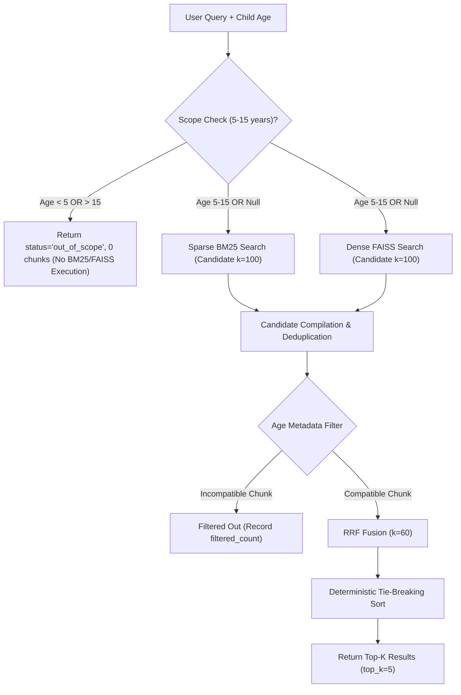

# Phase 3.4 — Sparse + Dense Hybrid Retriever Documentation

## 1. Purpose & Objectives
Phase 3.4 implements the NutriKid Pediatric Hybrid Sparse + Dense Knowledge Retriever (`preprocessing/retrieve.py`). The objective is to combine keyterm-precision sparse retrieval (BM25) with semantic vector search (FAISS IndexFlatIP via `BAAI/bge-small-en-v1.5`), integrated with a pediatric scope guardrail (5–15 years) and age-compatibility metadata filtering.

Key Capabilities Delivered:
- **Pediatric Scope Guardrail**: Immediate short-circuit termination (`status = "out_of_scope"`) for queries requesting ages $<5$ or $>15$.
- **Sparse BM25 Search**: Evaluates exact term frequencies on frozen preprocessed corpus using stored $k_1=1.5, b=0.75$.
- **Dense FAISS Vector Search**: Encodes queries into normalized 384-dimensional dense vectors and performs exact Cosine inner-product search against 6,422 indexed chunk vectors.
- **Metadata Age Filtering**: Filters out chunks incompatible with the target child age or default research range ($[5, 15]$).
- **Reciprocal Rank Fusion (RRF)**: Merges sparse and dense candidate ranks using $RRF(d) = \sum \frac{1}{60 + \text{rank}}$.
- **Deterministic Tie-Breaking**: Enforces strict ordering (RRF score DESC $\rightarrow$ sparse rank ASC $\rightarrow$ dense rank ASC $\rightarrow$ chunk_id ASC).

---

## 2. Architecture & Control Flow Diagram

---

## 3. Sparse BM25 Retrieval Specification
- **Index Reference**: Frozen `data/processed/bm25_index.json` (6,422 documents, 33,038 vocabulary terms).
- **Tokenizer**: `re.findall(r'\b\w+\b', query.lower())`.
- **BM25 Parameters**: $k_1 = 1.5, b = 0.75$.
- **Candidate Pool**: Top 100 BM25 candidate chunks (`sparse_candidates`).

---

## 4. Dense FAISS Vector Retrieval Specification
- **Embedding Model**: `BAAI/bge-small-en-v1.5` (dimension 384).
- **Query Normalization**: $L_2$ normalized vector ($|q|_2 = 1.0$) for exact Cosine similarity via inner product.
- **Index Reference**: Frozen `data/processed/dense_index.faiss` (6,422 vectors, `faiss.IndexFlatIP`).
- **Dense Mapping**: `data/processed/dense_index_map.json`.
- **Candidate Pool**: Top 100 FAISS candidate chunks (`dense_candidates`).

---

## 5. Pediatric Scope & Age Metadata Filtering Rules

### 5.1 Query-Level Scope Guardrail
- If `child_age < 5` OR `child_age > 15`:
  - `status = "out_of_scope"`
  - `scope_status = "out_of_scope"`
  - `results = []`
  - **Zero execution** of BM25 or FAISS vector calculations.

- If `child_age = null`:
  - `requested_age = null`
  - `effective_age_scope = [5, 15]`
  - `scope_status = "default_research_scope"`

### 5.2 Chunk-Level Age Metadata Compatibility
- If `requested_age` is specified (e.g. 10):
  - Reject chunk if `age_min != null AND requested_age < age_min`
  - Reject chunk if `age_max != null AND requested_age > age_max`

- If `requested_age` is `null`:
  - Reject chunk if `age_min != null AND age_min > 15`
  - Reject chunk if `age_max != null AND age_max < 5`

- Chunks with `null`/`null` age metadata are treated as general pediatric knowledge and allowed for all in-scope queries.

---

## 6. Reciprocal Rank Fusion (RRF) & Deterministic Tie-Breaking

### 6.1 RRF Formula ($k = 60$)
$$\text{RRF}(d) = \frac{1}{60 + \text{sparse\_rank}(d)} + \frac{1}{60 + \text{dense\_rank}(d)}$$
If a chunk is present in only one retriever's candidate pool, only that retriever's reciprocal rank contribution is summed.

### 6.2 Deterministic Sort Priority
1. `rrf_score` **DESCENDING**
2. `sparse_rank` **ASCENDING** (`None` $\rightarrow 999999$)
3. `dense_rank` **ASCENDING** (`None` $\rightarrow 999999$)
4. `chunk_id` **ASCENDING**

---

## 7. Retrieval Modes Supported
- `--mode bm25`: Pure BM25 sparse search with age metadata filtering applied.
- `--mode dense`: Pure FAISS dense vector search with age metadata filtering applied.
- `--mode hybrid`: RRF fused sparse-dense search with age metadata filtering applied.

---

## 8. Insufficient Candidates Handling
If the number of eligible candidate chunks after age filtering is less than requested `top_k`:
- `status = "insufficient_eligible_candidates"`
- Returns all available eligible candidates without duplication or dummy padding.
- `accounting` block records: `requested_top_k`, `returned_count`, `candidate_k`, `filtered_count`.

---

## 9. Automated Test Suite Results (`preprocessing/test_retriever.py`)

All 10 unit tests passed successfully:

| Test ID | Test Objective | Scope Status | Result Status | Result |
|---|---|---|---|---|
| `TEST 1` | Age=10, "Calcium RDA" query | `in_scope` | `success` | `PASS` |
| `TEST 2` | Age=15, "Red meat guidelines" query | `in_scope` | `success` | `PASS` |
| `TEST 3` | Age=4 out of scope query | `out_of_scope` | `out_of_scope` | `PASS` |
| `TEST 4` | Age=1 infant query | `out_of_scope` | `out_of_scope` | `PASS` |
| `TEST 5` | Age=16 adolescent query | `out_of_scope` | `out_of_scope` | `PASS` |
| `TEST 6` | Age=null default research scope | `default_research_scope` | `success` | `PASS` |
| `TEST 7` | Compare BM25, Dense, Hybrid & verify 100% determinism | `in_scope` | `success` | `PASS` |
| `TEST 8` | Candidate insufficiency handling ($k=10$, candidate $k=1$) | `in_scope` | `insufficient_eligible_candidates` | `PASS` |
| `TEST 9` | RRF formula & tie-breaking calculation verification | `in_scope` | `success` | `PASS` |
| `TEST 10` | Frozen asset MD5 integrity gate (77 files) | N/A | `PASS` | `PASS` |

---

## 10. Frozen Asset Integrity Verification Results

MD5 hashes were captured prior to execution and verified post-execution:

| Asset Category | Total Files | Modifications Detected | Status |
|---|---|---|---|
| **Raw PDFs (`knowledge_corpus/`)** | 32 PDFs | 0 | `PASSED` |
| **Manifest (`corpus_manifest.csv`)** | 1 CSV | 0 | `PASSED` |
| **Parsed JSONs (`data/processed/parsed/`)** | 22 JSONs | 0 | `PASSED` |
| **Chunk JSONs (`data/processed/chunks/`)** | 22 JSONs | 0 | `PASSED` |
| **Preprocessed Corpus (`preprocessed_corpus.json`)** | 1 JSON | 0 | `PASSED` |
| **BM25 Index (`bm25_index.json`)** | 1 JSON | 0 | `PASSED` |
| **FAISS Index (`dense_index.faiss`)** | 1 FAISS | 0 | `PASSED` |
| **Dense Map (`dense_index_map.json`)** | 1 JSON | 0 | `PASSED` |

---

## 11. System Limitations & Known Constraints
- **Scope Restriction**: Only pediatric queries for ages 5–15 years are processed. Out-of-scope queries return 0 results.
- **Candidate Pool Boundary**: RRF fusion operates over candidate $k=100$. Chunks outside top-100 in both sparse and dense rankings are not evaluated in RRF fusion.

---

## 12. Phase 3.4.1 Readiness Statement
Phase 3.4 Hybrid Retriever is fully implemented, verified, and ready for Phase 3.4.1 formal retrieval evaluation metrics (Recall@k, Precision@k, MRR, nDCG, MAP).
